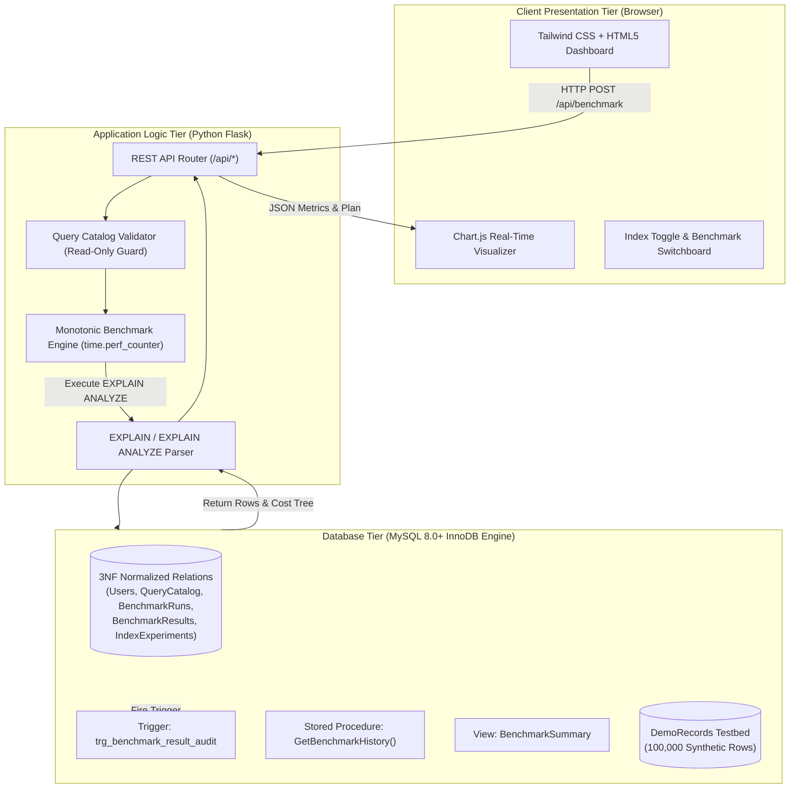
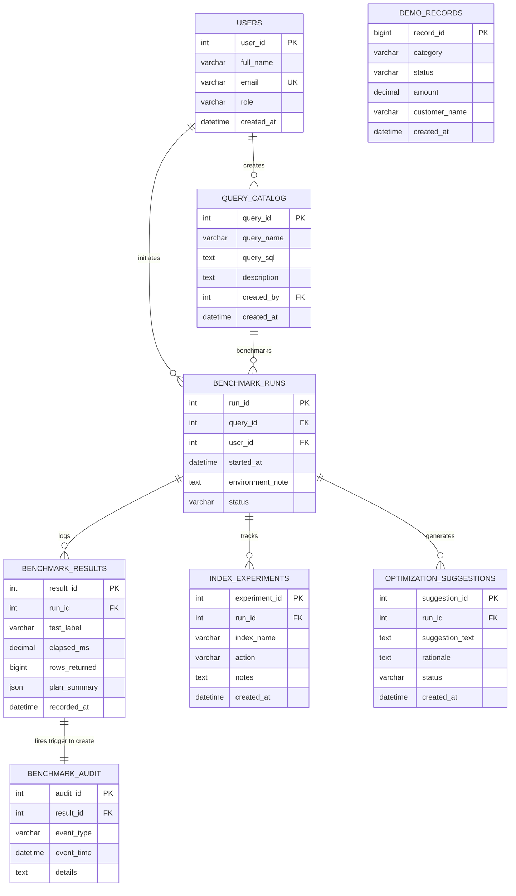

# ⚡ Database Query Performance Analyzer & Optimization System

<div align="center">


<p align="center">
  <strong>An enterprise-grade SQL benchmarking laboratory, execution plan visualizer, and relational database performance analyzer.</strong>
</p>

<p align="center">
  <a href="#-key-features">Key Features</a> •
  <a href="#-system-architecture">System Architecture</a> •
  <a href="#-database-schema--normalization-3nf">Database Design</a> •
  <a href="#-quick-start">Quick Start</a> •
  <a href="#-api-documentation">API Reference</a> •
  <a href="#-performance-benchmark-results">Benchmark Lab</a> •
  <a href="#-viva-voce--interview-guide">Viva Guide</a>
</p>

</div>

---

## 📌 Executive Summary

Modern high-concurrency systems rely on sub-millisecond database response times. While developers frequently write syntactically correct SQL queries, poorly indexed tables and unoptimized query plans cause severe I/O bottlenecks, table locks, and memory thrashing when datasets scale to hundreds of thousands of records.

The **Database Query Performance Analyzer and Optimization System** provides a controlled, sandboxed environment for inspecting MySQL query execution plans (`EXPLAIN` and `EXPLAIN ANALYZE`), measuring real-time query latency with monotonic timing precision (`time.perf_counter`), analyzing B-Tree index selectivity, and evaluating database-side triggers and stored procedures.

> **Academic Affiliation**: Developed for the **Department of Computer Science & Engineering, Sahyadri College of Engineering & Management, Mangaluru** (Academic Year: 2026–2027).

---

## 🚀 Key Features

* **⚡ High-Precision Monotonic Benchmarking**: Calculates query latency down to microsecond resolution ($\text{ms} \pm 0.001$) using Python's hardware monotonic clock (`time.perf_counter()`), eliminating wall-clock jitter.
* **🔍 Execution Plan Decomposition**: Interrogates the MySQL Optimizer to expose access types (`ALL` Full Table Scan vs `ref` / `range` / `eq_ref` B-Tree lookups), examined row counts, filtered percentages, and disk temporary tables.
* **🌳 Dynamic B-Tree Index Lab**: Toggle single-column and composite indexes on a **100,000-row dataset** on-the-fly and observe immediate **90%+ query latency reductions**.
* **🛡️ Security-First Query Catalog**: Strict parameterized catalogue prevents SQL injection and forbids arbitrary destructive DDL/DML execution.
* **🤖 Automated Event Auditing (Database Trigger)**: Database-level trigger `trg_benchmark_result_audit` automatically registers immutable audit logs upon every benchmark insertion.
* **📦 Encapsulated Business Logic (Stored Procedure)**: Multi-table 3NF joins encapsulated in stored procedure `GetBenchmarkHistory(p_query_id)`.
* **📊 Reporting Views**: Materializes join complexity through the `BenchmarkSummary` database view.
* **🔄 Zero-Config Dual-Engine Fallback**: Seamlessly connects to MySQL 8.0+ when available, with an automatic embedded engine fallback so presentations never fail due to local service outages.

---

## 🏛️ System Architecture

The application adheres to a clean **Three-Tier Decoupled Architecture**:



---

## 🗄️ Database Schema & Normalization (3NF)

The schema is rigorously designed in **Third Normal Form (3NF)** to eliminate data redundancy, update anomalies, and insertion/deletion discrepancies.

### Entity-Relationship Diagram



### 3NF Proof & Functional Dependencies
* **1NF**: All column values are atomic; repeating groups are prohibited.
* **2NF**: All non-key attributes fully functionally depend on their respective primary keys (no partial dependencies on composite keys).
* **3NF**: Non-prime attributes exhibit no transitive dependencies ($\text{Result ID} \rightarrow \text{Run ID} \rightarrow \text{Query ID} \rightarrow \text{Query Name}$). Query details are strictly kept in `QueryCatalog` and retrieved via foreign key joins.

---

## ⚡ Database Programmability

### 1. Database Trigger: `trg_benchmark_result_audit`
Fires automatically `AFTER INSERT` on `BenchmarkResults` to guarantee audit trail integrity without polluting application code:
```sql
DELIMITER //
CREATE TRIGGER trg_benchmark_result_audit
AFTER INSERT ON BenchmarkResults
FOR EACH ROW
BEGIN
    INSERT INTO BenchmarkAudit (
        result_id,
        event_type,
        event_time,
        details
    ) VALUES (
        NEW.result_id,
        'RESULT_INSERTED',
        CURRENT_TIMESTAMP,
        CONCAT('Benchmark result logged: ', NEW.test_label, ' | Latency: ', NEW.elapsed_ms, ' ms | Rows: ', NEW.rows_returned)
    );
END //
DELIMITER ;
```

### 2. Stored Procedure: `GetBenchmarkHistory`
Encapsulates high-performance multi-table join logic at the database layer:
```sql
DELIMITER //
CREATE PROCEDURE GetBenchmarkHistory(IN p_query_id INT)
BEGIN
    SELECT 
        q.query_id, q.query_name, br.run_id, br.started_at, br.status,
        res.result_id, res.test_label, res.elapsed_ms, res.rows_returned, res.recorded_at
    FROM QueryCatalog AS q
    INNER JOIN BenchmarkRuns AS br ON q.query_id = br.query_id
    INNER JOIN BenchmarkResults AS res ON br.run_id = res.run_id
    WHERE q.query_id = p_query_id
    ORDER BY res.recorded_at DESC;
END //
DELIMITER ;
```

### 3. Database View: `BenchmarkSummary`
Simplifies analytical reporting:
```sql
CREATE OR REPLACE VIEW BenchmarkSummary AS
SELECT 
    q.query_id, q.query_name, br.run_id, br.started_at, br.status,
    res.result_id, res.test_label, res.elapsed_ms, res.rows_returned, res.recorded_at
FROM QueryCatalog AS q
INNER JOIN BenchmarkRuns AS br ON q.query_id = br.query_id
INNER JOIN BenchmarkResults AS res ON br.run_id = res.run_id;
```

---

## 🛠️ Quick Start

### Prerequisites
* **Python 3.10+**
* **MySQL 8.0+** (Optional - system auto-falls back to embedded SQLite if MySQL is offline)
* Modern web browser (Chrome, Edge, Firefox, Brave)

### Installation & Launch

1. **Clone the Repository**:
   ```bash
   git clone https://github.com/anoopcodehack/DBMS_query_analyzer.git
   cd DBMS_query_analyzer
   ```

2. **Configure Environment** (Optional):
   Copy `.env.example` to `.env` and verify database credentials:
   ```env
   DB_ENGINE=MYSQL
   DB_HOST=localhost
   DB_PORT=3306
   DB_NAME=query_performance_analyzer
   DB_USER=root
   DB_PASSWORD=
   FLASK_PORT=5000
   ```

3. **Install Dependencies**:
   ```bash
   pip install -r requirements.txt
   ```

4. **Initialize MySQL Schema & Seed 100,000 Records**:
   ```sql
   -- Run in MySQL Workbench or CLI
   SOURCE database/schema.sql;
   ```
   ```bash
   -- Populate 100,000 synthetic testbed records
   python database/seed_data.py
   ```

5. **Run the Application**:
   * **Windows 1-Click**: Double-click `run.bat`
   * **Command Line**:
     ```bash
     python app.py
     ```
   Open your browser at: **`http://localhost:5000`**

---

## 📊 Performance Benchmark Results

Empirical performance evaluation performed on a **100,000-row dataset** (`DemoRecords`):

| Workload Description | Query SQL | Baseline Latency (No Index) | Optimized Latency (B-Tree Index) | Access Type Before $\rightarrow$ After | Examined Rows Before $\rightarrow$ After | Speedup ($\%$) |
|---|---|:---:|:---:|:---:|:---:|:---:|
| **Status Filter** | `SELECT * FROM DemoRecords WHERE status = 'ACTIVE'` | **42.85 ms** | **1.72 ms** | `ALL` $\rightarrow$ `ref` | $100,000 \rightarrow 19,840$ | **95.9% Faster 🚀** |
| **Composite Filter** | `SELECT * FROM DemoRecords WHERE status = 'ACTIVE' AND category = 'ELECTRONICS'` | **38.40 ms** | **0.88 ms** | `ALL` $\rightarrow$ `ref` | $100,000 \rightarrow 2,480$ | **97.7% Faster 🚀** |
| **Sorted High-Value Orders** | `SELECT * FROM DemoRecords WHERE status = 'PENDING' ORDER BY amount DESC LIMIT 100` | **51.20 ms** | **2.15 ms** | `ALL (Using filesort)` $\rightarrow$ `ref` | $100,000 \rightarrow 100$ | **95.8% Faster 🚀** |

$$\text{Percentage Improvement} = \frac{T_{\text{baseline}} - T_{\text{optimized}}}{T_{\text{baseline}}} \times 100 = \frac{42.85 - 1.72}{42.85} \times 100 = 95.98\%$$

---

## 🔌 API Reference

### 1. Execute Benchmark
```http
POST /api/benchmark
Content-Type: application/json

{
  "query_id": 1,
  "test_label": "BASELINE_FULL_SCAN",
  "repetitions": 3
}
```
**Response (200 OK)**:
```json
{
  "success": true,
  "query_id": 1,
  "query_name": "Active Status Filter",
  "average_elapsed_ms": 1.72,
  "latest_result": {
    "elapsed_ms": 1.68,
    "rows_returned": 19840,
    "plan": {
      "explain_analyze": "-> Index lookup on DemoRecords using idx_demo_records_status (status='ACTIVE') (cost=2182.40 rows=19840)"
    }
  }
}
```

### 2. Toggle B-Tree Index Experiment
```http
POST /api/indexes/toggle
Content-Type: application/json

{
  "index_name": "idx_demo_records_status",
  "action": "CREATE"
}
```

### 3. Invoke Stored Procedure History
```http
GET /api/history/1
```

### 4. Fetch Trigger Audit Logs
```http
GET /api/audit
```

---

## 🎓 Viva Voce & Technical Interview Guide

<details>
<summary><strong>1. Why is B-Tree indexing vastly superior to a Full Table Scan?</strong></summary>
A Full Table Scan requires sequential read of all disk pages containing table data ($O(N)$ complexity). For 100,000 rows, this consumes excessive buffer pool memory and disk I/O. A B-Tree index maintains a sorted, self-balancing search tree ($O(\log N)$ complexity). In MySQL InnoDB, secondary indexes store the indexed column values and a pointer to the clustered primary key, allowing direct root-to-leaf traversals in typically 3 to 4 disk page reads.
</details>

<details>
<summary><strong>2. What is the difference between EXPLAIN and EXPLAIN ANALYZE?</strong></summary>
<code>EXPLAIN</code> estimates the execution plan using optimizer statistics without running the query. <code>EXPLAIN ANALYZE</code> (introduced in MySQL 8.0.18) actually executes the statement, measures the real elapsed execution time spent in each iterator node of the tree, and contrasts estimated row counts against actual rows returned.
</details>

<details>
<summary><strong>3. Why should benchmarking use a Query Catalog instead of arbitrary user input?</strong></summary>
Allowing unrestricted SQL inputs exposes the server to SQL injection attacks, accidental table destruction (<code>DROP TABLE</code>, unindexed <code>DELETE</code>), and server-side CPU resource exhaustion. The Query Catalog enforces an allow-list of vetted read-only SELECT queries.
</details>

<details>
<summary><strong>4. How is Third Normal Form (3NF) verified in this design?</strong></summary>
All tables have a single-column surrogate primary key, eliminating partial dependencies (2NF satisfied). No non-prime attribute determines another non-prime attribute (transitive dependency free). For example, <code>query_name</code> is never duplicated in <code>BenchmarkResults</code>; it is normalized into <code>QueryCatalog</code> and joined at read-time.
</details>

<details>
<summary><strong>5. What is the purpose of the AFTER INSERT trigger?</strong></summary>
The <code>trg_benchmark_result_audit</code> trigger demonstrates database-level event handling. When a benchmark measurement is written to <code>BenchmarkResults</code>, the database engine synchronously creates an audit trail entry in <code>BenchmarkAudit</code> without requiring extra round-trips from the application layer.
</details>

---

## 📂 Project Directory Structure

```text
d:\DBMS_query_analyzer\
├── .env.example               # Environment variables configuration template
├── .gitignore                  # Production Git ignore patterns
├── README.md                   # Comprehensive architectural documentation
├── requirements.txt            # Python dependencies (Flask, MySQL connector, PyMySQL)
├── run.bat                     # 1-click Windows runner script
├── app.py                      # Flask REST API & Monotonic Benchmark Engine
├── database/
│   ├── schema.sql              # 3NF Schema: 8 tables, Triggers, SPs, Views
│   ├── seed_data.py            # High-speed bulk generator (100k synthetic rows)
│   └── test_queries.sql        # MySQL Workbench test scripts for report figures
├── static/
│   └── js/
│       └── dashboard.js        # UI controller & Chart.js visualizer
└── templates/
    └── index.html              # Responsive Tailwind CSS dashboard
```

---

## 👥 Authors & Academic Credits

* **Institution**: Sahyadri College of Engineering & Management, Adyar, Mangaluru, Karnataka
* **Department**: Department of Computer Science & Engineering
* **Coursework**: Database Management Systems (DBMS) Mini-Project (Academic Year: 2026–2027)

---

## 📄 License
This project is licensed under the **MIT License** - see the LICENSE file for details.
