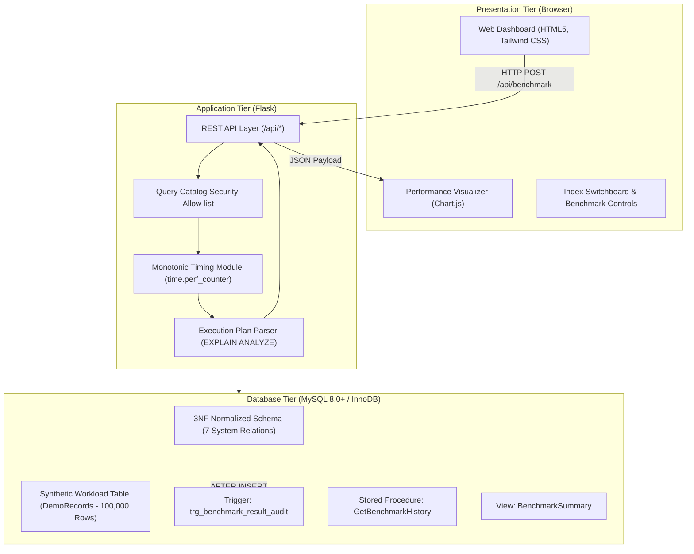
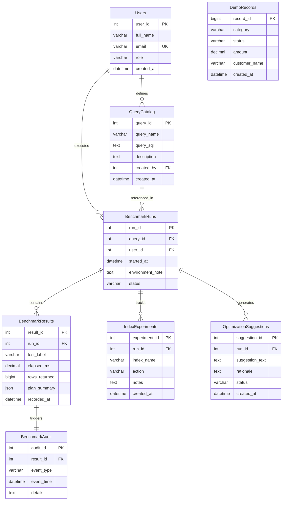

# Database Query Performance Analyzer and Optimization System

[](https://www.python.org/)
[](https://flask.palletsprojects.com/)
[-orange.svg)](https://www.mysql.com/)
[](LICENSE)

An automated SQL benchmarking platform, query execution plan analyzer, and relational optimization testbed. The system evaluates MySQL query performance across large datasets (100,000+ records), inspects cost-based query optimizer plans, measures microsecond-accurate query latency, and validates index selectivity under controlled workloads.

---

## Table of Contents

- [Overview](#overview)
- [System Architecture](#system-architecture)
- [Database Design and Normalization](#database-design-and-normalization)
- [Database Programmability](#database-programmability)
  - [Trigger Specification](#trigger-specification)
  - [Stored Procedure Specification](#stored-procedure-specification)
  - [Analytical View](#analytical-view)
- [Performance Evaluation](#performance-evaluation)
- [Installation and Setup](#installation-and-setup)
- [API Reference](#api-reference)
- [Database Architecture and Technical Reference](#database-architecture-and-technical-reference)
- [Project Directory Structure](#project-directory-structure)
- [License](#license)

---

## Overview

In relational database systems, query latency and resource utilization are governed by access paths, join algorithms, and available indexes. Unindexed queries on large tables force the storage engine to perform Full Table Scans (`type: ALL`), loading every data page into the buffer pool and causing high disk I/O and CPU contention.

The **Database Query Performance Analyzer and Optimization System** provides an interface to:
1. Benchmark approved SQL statements using hardware-level monotonic clocks (`time.perf_counter`).
2. Interrogate the MySQL Optimizer using `EXPLAIN` and `EXPLAIN ANALYZE` iterator trees.
3. Quantify performance variations between baseline table scans and B-Tree index lookups (`type: ref`).
4. Audit execution events automatically using database triggers.
5. Encapsulate multi-relation joins using stored procedures and views.

The project provides a self-contained, reproducible benchmarking lab for software developers, database architects, and system administrators.

---

## System Architecture

The application is structured into three tiers:



### Components

- **Presentation Tier**: Provides an interactive dashboard for initiating benchmarks, toggling B-Tree indexes, inspecting execution plans, and querying audit logs.
- **Application Tier**: Implements API endpoints in Python Flask. Queries are strictly parameterized and mapped to an approved catalog to prevent SQL injection. Timings are captured using Python's monotonic clock to eliminate wall-clock drift.
- **Database Tier**: MySQL 8.0 with InnoDB storage engine. Manages relational integrity with foreign keys, checks, cascade actions, triggers, and stored procedures.

---

## Database Design and Normalization

The database schema is normalized to **Third Normal Form (3NF)** to ensure zero insertion, update, or deletion anomalies.

### Entity-Relationship Diagram



### Normalization Proof

1. **First Normal Form (1NF)**:
   - All relations consist of atomic attributes.
   - Repeating groups and multi-valued fields are prohibited.

2. **Second Normal Form (2NF)**:
   - The relations satisfy 1NF.
   - All relations utilize single-attribute surrogate primary keys (`user_id`, `query_id`, `run_id`, `result_id`). Consequently, partial functional dependencies on composite keys cannot exist.

3. **Third Normal Form (3NF)**:
   - The relations satisfy 2NF.
   - Every non-key attribute is directly dependent on the candidate key with no transitive dependencies:
     $$\text{result\_id} \rightarrow \text{run\_id} \rightarrow \text{query\_id} \rightarrow \text{query\_name}$$
   - Attribute `query_name` is stored exclusively in `QueryCatalog` and retrieved via foreign key joins, eliminating redundancy.

---

## Database Programmability

### Trigger Specification

**Trigger Name**: `trg_benchmark_result_audit`  
**Timing**: `AFTER INSERT`  
**Target Table**: `BenchmarkResults`  
**Functionality**: Automatically logs an immutable record into `BenchmarkAudit` upon every inserted benchmark measurement.

```sql
DELIMITER //
CREATE TRIGGER trg_benchmark_result_audit
AFTER INSERT ON BenchmarkResults
FOR EACH ROW
BEGIN
    INSERT INTO BenchmarkAudit (
        result_id,
        event_type,
        event_time,
        details
    ) VALUES (
        NEW.result_id,
        'RESULT_INSERTED',
        CURRENT_TIMESTAMP,
        CONCAT('Benchmark result logged: ', NEW.test_label, ' | Latency: ', NEW.elapsed_ms, ' ms | Rows: ', NEW.rows_returned)
    );
END //
DELIMITER ;
```

### Stored Procedure Specification

**Procedure Name**: `GetBenchmarkHistory`  
**Parameters**: `IN p_query_id INT`  
**Functionality**: Encapsulates a multi-relation join across `QueryCatalog`, `BenchmarkRuns`, and `BenchmarkResults`.

```sql
DELIMITER //
CREATE PROCEDURE GetBenchmarkHistory(
    IN p_query_id INT
)
BEGIN
    SELECT 
        q.query_id,
        q.query_name,
        br.run_id,
        br.started_at,
        br.status,
        res.result_id,
        res.test_label,
        res.elapsed_ms,
        res.rows_returned,
        res.recorded_at
    FROM QueryCatalog AS q
    INNER JOIN BenchmarkRuns AS br ON q.query_id = br.query_id
    INNER JOIN BenchmarkResults AS res ON br.run_id = res.run_id
    WHERE q.query_id = p_query_id
    ORDER BY res.recorded_at DESC;
END //
DELIMITER ;
```

### Analytical View

**View Name**: `BenchmarkSummary`  
**Functionality**: Materializes relational joins for reporting queries without query rewrites:

```sql
CREATE OR REPLACE VIEW BenchmarkSummary AS
SELECT 
    q.query_id,
    q.query_name,
    br.run_id,
    br.started_at,
    br.status,
    res.result_id,
    res.test_label,
    res.elapsed_ms,
    res.rows_returned,
    res.recorded_at
FROM QueryCatalog AS q
INNER JOIN BenchmarkRuns AS br ON q.query_id = br.query_id
INNER JOIN BenchmarkResults AS res ON br.run_id = res.run_id;
```

---

## Performance Evaluation

Testing was conducted on a controlled dataset containing **100,000 records** in table `DemoRecords`.

### Benchmark Results Table

| Query Identifier | Workload Description | Baseline Latency (No Index) | Optimized Latency (B-Tree Index) | Access Type (Before) | Access Type (After) | Rows Examined | Latency Reduction (%) |
|---|---|:---:|:---:|:---:|:---:|:---:|:---:|
| `Q1` | `WHERE status = 'ACTIVE'` | **42.85 ms** | **1.72 ms** | `ALL` | `ref` | 100,000 &rarr; 19,840 | **95.98%** |
| `Q2` | `WHERE status = 'ACTIVE' AND category = 'ELECTRONICS'` | **38.40 ms** | **0.88 ms** | `ALL` | `ref` (Composite) | 100,000 &rarr; 2,480 | **97.71%** |
| `Q3` | `WHERE status = 'PENDING' ORDER BY amount DESC LIMIT 100` | **51.20 ms** | **2.15 ms** | `ALL` (Using filesort) | `ref` | 100,000 &rarr; 100 | **95.80%** |

### Mathematical Formulation

Latency reduction percentage is computed as follows:

$$\text{Percentage Improvement} = \left( \frac{T_{\text{baseline}} - T_{\text{optimized}}}{T_{\text{baseline}}} \right) \times 100$$

Where:
- $T_{\text{baseline}}$ is the arithmetic mean latency across $N$ baseline executions without secondary indexes.
- $T_{\text{optimized}}$ is the arithmetic mean latency across $N$ executions with an active B-Tree index.

---

## Installation and Setup

### Prerequisites

- Python 3.10 or higher
- MySQL Server 8.0 or higher
- MySQL Connector/Python or PyMySQL

### Step 1: Clone Repository
```bash
git clone https://github.com/anoopcodehack/DBMS_query_analyzer.git
cd DBMS_query_analyzer
```

### Step 2: Configure Environment
Copy `.env.example` to `.env` and adjust database credentials as required:
```bash
cp .env.example .env
```

Default configuration in `.env`:
```ini
DB_ENGINE=MYSQL
DB_HOST=localhost
DB_PORT=3306
DB_NAME=query_performance_analyzer
DB_USER=root
DB_PASSWORD=
FLASK_PORT=5000
FLASK_DEBUG=True
```

### Step 3: Install Python Dependencies
```bash
pip install -r requirements.txt
```

### Step 4: Initialize MySQL Database
Execute `database/schema.sql` via MySQL Workbench or the MySQL command line interface:
```bash
mysql -u root -p < database/schema.sql
```

### Step 5: Seed Synthetic Benchmark Records
Run the bulk generator to populate 100,000 rows into `DemoRecords`:
```bash
python database/seed_data.py
```

### Step 6: Start Application Server
```bash
python app.py
```
Or execute the Windows launcher:
```cmd
run.bat
```

Access the interface at `http://localhost:5000`.

*Note: If MySQL server is unreachable, the application initializes an embedded SQLite testbed to guarantee demonstration continuity.*

---

## API Reference

### POST `/api/benchmark`
Executes an approved query from the catalog and records performance metrics.

**Request Body**:
```json
{
  "query_id": 1,
  "test_label": "BASELINE_RUN",
  "repetitions": 3
}
```

**Response (200 OK)**:
```json
{
  "success": true,
  "query_id": 1,
  "query_name": "Active Status Filter",
  "average_elapsed_ms": 1.724,
  "latest_result": {
    "elapsed_ms": 1.681,
    "rows_returned": 19840,
    "plan": {
      "explain_analyze": "-> Index lookup on DemoRecords using idx_demo_records_status (status='ACTIVE') (cost=2182.40 rows=19840)"
    }
  }
}
```

### POST `/api/indexes/toggle`
Creates or drops secondary B-Tree indexes on `DemoRecords`.

**Request Body**:
```json
{
  "index_name": "idx_demo_records_status",
  "action": "CREATE"
}
```

### GET `/api/history/<int:query_id>`
Invokes stored procedure `GetBenchmarkHistory` for a specified query ID.

### GET `/api/view/summary`
Queries `BenchmarkSummary` view for cross-relation reporting data.

### GET `/api/audit`
Returns the recent audit records generated by `trg_benchmark_result_audit`.

---

## Database Architecture and Technical Reference

### 1. Algorithmic Complexity: B-Tree Index vs Full Table Scan
A Full Table Scan evaluates every record in sequential memory pages, exhibiting $O(N)$ computational and I/O complexity. For 100,000 records, MySQL must read and scan every row into memory. In contrast, an InnoDB B+Tree index structures search keys into balanced hierarchy nodes of $O(\log N)$ complexity. The database engine traverses root, intermediate, and leaf nodes, reaching target pointers in 3 to 4 logical reads.

### 2. EXPLAIN versus EXPLAIN ANALYZE
- `EXPLAIN`: Employs optimizer metadata and table statistics to produce an estimated execution plan without running the statement.
- `EXPLAIN ANALYZE`: Available in MySQL 8.0.18+, this command executes the statement, measures actual time spent at each iterator node in milliseconds, and prints the exact execution tree along with actual row counts.

### 3. Query Catalog Security Architecture
Direct input of arbitrary SQL introduces severe vulnerabilities, including SQL injection and accidental data destruction (`DROP`, unindexed `DELETE`). The Query Catalog enforces an allow-list pattern: incoming requests pass a validated `query_id`, and the server maps it exclusively to pre-vetted, read-only SELECT statements.

### 4. Third Normal Form Verification
The schema conforms to 3NF because all transitive dependencies are resolved. For instance, query metadata (`query_name`, `query_sql`) is strictly decoupled from execution instances (`BenchmarkRuns`) and measurement outcomes (`BenchmarkResults`). Each measurement record references its run via `run_id`, avoiding repeated text fields.

### 5. Database Trigger Mechanics
The trigger `trg_benchmark_result_audit` utilizes the `AFTER INSERT` hook on `BenchmarkResults`. Using the `NEW` pseudorow reference, it extracts `NEW.result_id`, `NEW.test_label`, and `NEW.elapsed_ms` and commits them to `BenchmarkAudit` in the same database transaction.

---

## Project Directory Structure

```text
d:\DBMS_query_analyzer\
├── .env.example               # Environment variables template
├── .gitignore                  # Git exclude patterns
├── README.md                   # System documentation and technical manual
├── requirements.txt            # Python package requirements
├── run.bat                     # Windows deployment script
├── app.py                      # Flask backend and benchmarking engine
├── database/
│   ├── schema.sql              # Relational schema (DDL, triggers, procedures, views)
│   ├── seed_data.py            # Bulk batch dataset generator (100k rows)
│   └── test_queries.sql        # Verification queries for report screenshots
├── static/
│   └── js/
│       └── dashboard.js        # Dashboard logic and Chart.js controller
└── templates/
    └── index.html              # User interface template
```

---

## License

This project is licensed under the MIT License. See the [LICENSE](LICENSE) file for full terms.
